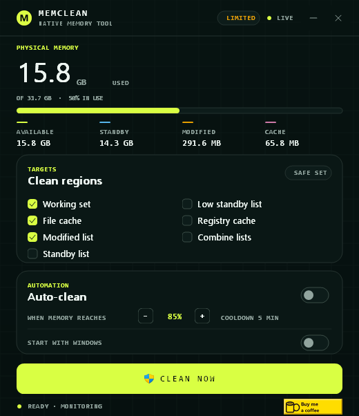

<div align="center">

# MemClean

**A small native Windows memory cleaner written in C23.**

[Website](https://thejuampi.github.io/memclean/) &middot; [Downloads](https://github.com/Thejuampi/memclean/releases) &middot; [Source](https://github.com/Thejuampi/memclean) &middot; [Buy me a coffee](https://buymeacoffee.com/thejuampi)

</div>



MemClean frees working sets, flushes the system file cache, and purges standby lists from a compact Win32 window. The GUI and the CLI share the same engine. Cleaning needs administrator rights; status does not.

## Features

| | |
|---|---|
| **Clean regions** | Working sets, file cache, modified page list, standby list, low-priority standby list, registry hives, and memory list combine |
| **Presets** | Safe default set, every region, or any combination |
| **Auto-clean** | Runs when memory load reaches your threshold, with a cooldown |
| **Start with Windows** | Optional per-user startup entry |
| **Tray support** | Close to tray, restore, clean, or elevate |
| **No runtime** | No Visual C++ runtime and no C runtime DLLs |
| **Two frontends** | `memclean.exe` for the desktop and `memclean-cli.exe` for scripts |

## Download

Get the latest binaries from [GitHub Releases](https://github.com/Thejuampi/memclean/releases):

- [memclean.exe](https://github.com/Thejuampi/memclean/releases/latest/download/memclean.exe)
- [memclean-cli.exe](https://github.com/Thejuampi/memclean/releases/latest/download/memclean-cli.exe)

The desktop build targets Windows 10 and 11 x64. The executables are unsigned; Windows may show a warning.

## Build from source

Requirements: GCC 15.2 or newer with MinGW-w64, plus `windres`.

```bat
build.bat
```

The build produces `memclean.exe` and `memclean-cli.exe` in the repository root.

Formatting uses clang-format:

```bat
format.bat
lint.bat
```

## CLI

```text
memclean-cli status
memclean-cli clean --working --filecache --modified
memclean-cli clean --all --force
```

`clean` requires an elevated terminal unless `--force` is used. `--force` attempts the operations anyway and reports each failure.

## Architecture

The project keeps a pure C core apart from the platform shell:

- `memclean_core.c` / `memclean_core.h`: flags, parsing, settings normalization, masks, auto-clean decisions, report checks, status names, and formatting. No Win32, no IO, no global state.
- `memclean_engine.c`: NT memory APIs.
- `memclean_runtime.S`: x86-64 assembly for `memset`, `memcpy`, and `memmove`, with SSE2 and AVX2 paths selected by CPUID.
- `memclean_host.c`: registry, tray, worker process, and elevation.
- `memclean_view.c`: Win32 controls and GDI+ painting.
- `memclean_report.c`: CLI output.
- `memclean_gui.c`: window lifecycle and state transitions.
- `memclean_strings.c`: shared UI text.

## GitHub Pages

The site lives in `docs/` and publishes from that folder. In the repository settings, open **Pages** and select **Deploy from a branch**, then choose the default branch and `/docs`.

The download buttons expect `memclean.exe` and `memclean-cli.exe` as assets on the latest GitHub release. Build both files with `build.bat`, then attach them to the release.

## More apps

- [IntelBurnTest](https://thejuampi.github.io/ibt-asm/): CPU stability testing for Windows, Linux, and bootable USB.
- [Thejuampi on GitHub](https://github.com/Thejuampi).

## Support

MemClean is free software. If it saves you time, [buy me a coffee](https://buymeacoffee.com/thejuampi).

## License

GPL-3.0-or-later. See `LICENSE`.
